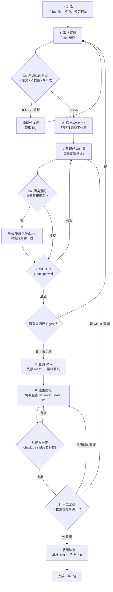

# Loop / Graph 設計

## 最終版流程圖（v2，實際執行後修改過）

## 文字版
取得資料 → **來源狀態判定** → 寫 raw → 整理成 wiki → **衝突登記** → Wiki Lint →（下一篇）… → 查詢 Wiki → 產生簡報 → 簡報檢查 → 人工審稿 → 版面檢查 → 完成

## 哪些步驟會重複？
| Loop | 範圍 | 何時結束 |
|------|------|----------|
| **Ingest loop** | 1 → 4 | 每篇來源跑一次，直到 ≥5 篇且 lint 通過 |
| **替代來源 loop** | 1 → 1a → 換來源 → 1 | 取得失敗時；本次天下雜誌 403 跑了一次 |
| **Wiki 修正 loop** | 3 ↔ 4 | lint 有錯就回去改 wiki |
| **簡報修正 loop** | 6 ↔ 7 | 檢查器有錯就重新生成那幾張 |
| **回溯 loop** | 8 → 3 | 人工審稿發現錯在 wiki，就回到 wiki 改，而不是只改簡報 |

## 哪些地方要檢查或重新生成？
| 檢查點 | 檢查什麼 | 失敗時 |
|--------|----------|--------|
| 1a 來源狀態 | 有沒有真的讀到原文？ | ❌ 換來源；⚠️ 照收但標待驗證 |
| 3a 衝突登記 | 兩個來源說法一樣嗎？ | 不自己選邊，寫進爭議表並註明採用理由 |
| 4 Wiki Lint | W1 每條事實都有 [S#]、W2 來源存在 | 回 3 補標籤或刪掉 |
| 7 簡報檢查 | D1 有宣告依據、D2 數字找得到、D3 起源要有「一說」、D4 待驗證內容要標示、D5 不用已排除的說法 | 回 6 重新生成該張 |
| 8 人工審稿 | 標了 [S#] 但來源其實沒這樣說（推論） | 回 3 或 6 |
| 9 版面 | 手機寬度、文字溢出 | 改 CSS |

## 為什麼這樣設計？
1. **錯越早抓越便宜**：一個錯的事實如果進了 wiki，之後每次查詢、每份簡報都會帶著它。所以最重要的檢查放在 wiki 這一層，而不是只檢查最後的簡報。
2. **讓「依據」可以被機器檢查**：每張投影片都宣告 `data-wiki` 和 `data-src`，檢查器才能逐張比對數字有沒有出處。沒有宣告，就只能靠人眼。
3. **不讓模型自己選邊**：來源矛盾時，LLM 很容易挑一個聽起來合理的寫上去。強制寫進爭議表，讓「選哪一說」成為看得到、可以回頭查的決定。
4. **機器檢查抓不到的，留給人工**：檢查器只能確認「有沒有標籤」，不能確認「標籤對不對」，所以最後保留一個人工審稿節點。
